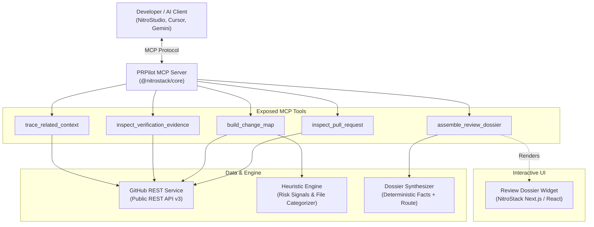

# PRPilot — Evidence-Driven Pull Request Intelligence

> **"Know where to look before you review."**

PRPilot is an MCP-powered pull-request investigation system built with the official **NitroStack** framework. It solves reviewer context-switching by aggregating facts from GitHub, analyzing change risk heuristics, verifying actual CI test evidence, tracing explicit issue references, and compiling a structured, evidence-linked **Review Dossier**.

---

## 🎯 The Problem

Code reviewers are forced to cross-reference multiple pages to answer basic questions:
- *What is the real scope and architectural impact of this change?*
- *Which sensitive files (auth, config, DB, validation) were modified?*
- *Did the CI tests actually run and pass, or was there no CI at all?*
- *What issue was this fixing, and does the code address it?*
- *Where should I begin reading the diff?*

PRPilot investigates public GitHub pull requests, extracts verifiable facts, maps out architectural changes, highlights investigation signals, and generates a prioritized reviewer route.

---

## 🏗️ Architecture



---

## ⚡ Core MCP Tools

1. **`inspect_pull_request`**
   - Retrieves pull request metadata: title, description, author, branch targets, commit SHA, timestamps, and overall file statistics.
   - Accurately reports non-existent PRs and rate limits.

2. **`build_change_map`**
   - Categorizes changed files into: `Application Logic`, `Tests`, `Configuration & Dependencies`, `Documentation`, and `Other`.
   - Runs transparent risk heuristics on security-sensitive paths (e.g., auth, permissions, crypto, manifests, database migrations).
   - Enforces diff bounding and records patch truncation.

3. **`inspect_verification_evidence`**
   - Retrieves real commit checks and statuses for the PR head SHA.
   - Distinguishes passing, failing, pending, and **missing/absent** checks (never assumes an empty check list means tests pass).

4. **`trace_related_context`**
   - Parses explicit issue and PR references in descriptions and commit messages.
   - Fetches issue titles, states, and links to ground the review in historical context.

5. **`assemble_review_dossier`**
   - Unifies all collected evidence into a cohesive, structured Review Dossier.
   - Produces a prioritized 3–5 step reviewer route with direct file links and rationale.
   - Powers the interactive **Review Dossier Widget**.

---

## 🚀 Quick Start

### Prerequisites
- Node.js 20.x or higher
- npm 9+

### Installation
```bash
# Clone the repository
git clone https://github.com/ayushv7/PRPilot.git
cd PRPilot

# Install root & widget dependencies
npm run install:all
```

### Environment Configuration
Copy `.env.example` to `.env`:
```bash
cp .env.example .env
```
*(Optional: add `GITHUB_TOKEN` to increase GitHub API rate limits from 60 to 5,000 requests/hr).*

### Running Locally
```bash
# Start MCP server and Widget dev server
npm run dev
```

### Building for Production
```bash
npm run build
npm start
```

---

## 🛡️ Security & Integrity Principles

- **Read-Only MVP:** Does not modify PRs, submit automated comments, or trigger actions.
- **Untrusted Input Protection:** All PR content (titles, descriptions, comments) is treated as untrusted text and isolated from execution flows.
- **No Hallucinated Approvals:** Missing CI or incomplete evidence is explicitly reported as unknown/missing.
